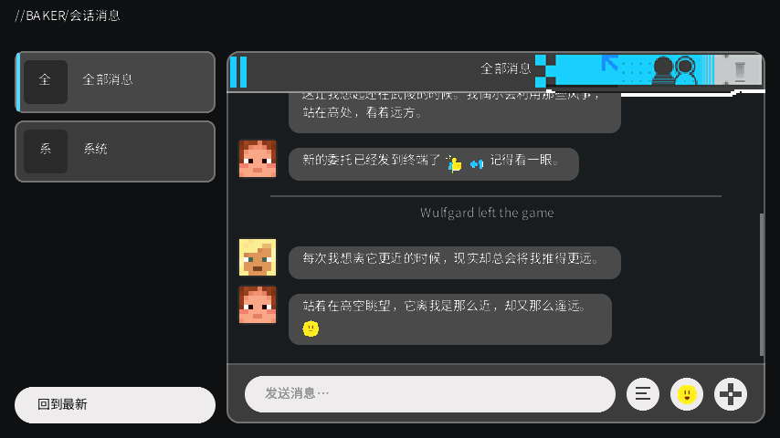

# Baker Chat

把 Minecraft 的聊天框换成《明日方舟：终末地》里 Baker 的会话界面。

按 `T`（或你改过的“聊天”键）打开。左边是会话列表，右边是消息，底部是输入栏。
按 `Esc` 关掉面板回到游戏。



## 环境

- Minecraft 1.20.4
- Fabric Loader ≥ 0.15
- Fabric API `0.97.x+1.20.4`
- Java 17+

## 装法

1. 把 `baker-chat-0.1.0.jar` 丢进 `.minecraft/mods`
2. 同时装好 Fabric API
3. 启动游戏，按 `T`

## 已经有的

- 全屏面板：左列表 + 右消息 + 底部输入，版式照 Baker 摆的；尺寸按“薄”调过（卡片 34px、输入栏 32px）
- 会话列表自动列出在线玩家，点谁就只看谁说的话；另有「全部消息」「系统」
- 头像用玩家皮肤（按 UUID 找 tab 列表里的皮肤，找不到就用默认皮肤），取 64x64 皮肤里 (8,8) 的 8x8 脸部
- 系统消息（加入/退出、公告、指令回执）走居中的灰色状态行
- 消息按发送者分组：同一个人连发的消息共用一个头像，气泡往上叠；自己的靠右、浅色
- **指令补全**：敲 `/` 在输入框上方弹出补全列表（自绘，Baker 字体），
  Tab 在候选里循环、↑↓ 选择、也可以直接点
- **右下角三个按钮**：
  - 左（三条横线）：最近发送过的指令，点一条放进输入框，由你自己决定发不发
  - 中（笑脸）：表情面板，三个标签——表情（Baker 的 38 个）、贴纸（152 张）、颜文字（48 个）
  - 右（+）：插入分隔线 / 插入状态文字 / 清空本地记录
- **贴纸**：点一下就作为一张 64x64 的图插进会话（像 Baker 的贴纸消息）。**只在本地显示，不会发给服务器**
- **颜文字**：点一下直接插进输入框
- 滚轮翻历史、滚到底自动跟随、左下角「回到最新」、上下键翻发送历史
- **记录会落盘**：`config/baker-chat-history.json`，最多 400 条。
  按「服务器地址」或「存档名」区分——重开游戏、重进同一个世界都还在；
  换了服务器/存档就从新的一份开始（"清空本地记录"会连文件一起清掉）
- 最近命令在同一个世界内一直保留，换世界时清空

## 字体

面板里的文字（标题、列表、气泡、输入框、补全列表）用 **Noto Sans SC**，
以字体样式的方式只作用在面板自己绘制的文本上——**游戏本体的字体没有改动**。

字体文件在 `assets/baker/font/`（SIL OFL 1.1，见同目录 `OFL.txt`）。

Baker 用的 HarmonyOS Sans 在仓库里只有 140KB 的拉丁子集（零个汉字），
没法直接拿来显示中文，所以换成了 Noto；可变字体默认字重是 Thin(100)，
用 fontTools 固化成了 400。

另外混了一个 mixin：原版字体图集是最近邻采样，TTF 字形按 2 倍渲染再缩回去时
会被丢掉一半像素（看起来像棋盘格抖动）。`GlyphAtlasTextureMixin` 把图集改成线性过滤，
字形边缘才平滑。

输入框是“原版 widget 管输入、自己管显示”：widget 只负责键盘、光标位置、IME，
文字和光标全部由面板绘制（不调用它的 render，否则会和我们画的重影）。
代价是选中文本时看不到高亮。

## 圆角

GUI 是按整数倍缩放的，直接按逻辑像素画圆角，一格就是 2~3 个屏幕像素。
`BakerDraw.roundRect` 现在会把形状放大一倍、用矩阵缩回去再画，
相当于给形状做 2x 超采样，弧线上的台阶细一半。

## 已知问题

- 消息里的点击和悬浮事件没有接（`Text` 里的 click/hover 目前丢掉）
- 贴纸（Baker 那种大图）还没做，只有表情
- MC 的 UI 网格是 9px 一级，圆角在 GUI 缩放较大时仍会有轻微的阶梯感
- 面板替换的是“按 T 打开的那个界面”，左下角的原版聊天 HUD 没动

## 自己编译

需要 JDK 17+ 和网络：

```bash
gradle build
```

产物在 `build/libs/baker-chat-0.1.0.jar`。

`gradle.properties` 里有四行代理设置（`127.0.0.1:7897`），是给这台机器拉 Fabric 依赖用的，
换台机器编译时删掉，或者改成你自己的代理。

素材由 `tools/prepare-textures.ps1` 从 Baker 的原始资源缩放生成，
输出到 `src/main/resources/assets/baker/textures/ui/`，重跑一次就能重新生成。

调试时想直接看界面，不建世界也可以，给客户端加 JVM 参数：

```
-Dbakerchat.debug.open=true    # 标题画面直接打开面板并塞几条假消息
-Dbakerchat.debug.emoji=true   # 顺便把表情面板打开
-Dbakerchat.debug.menu=true    # 顺便把更多菜单打开
```

## 素材来源

界面素材取自 [baker-dx](https://github.com/Wanye-7300/baker-dx)（代码 MIT，`assets/` 除外），
原素材版权归上海鹰角网络科技有限公司所有。这个 mod 只是自用，不发布、不商用。

## 许可

代码 MIT。素材别当成 MIT 用。
